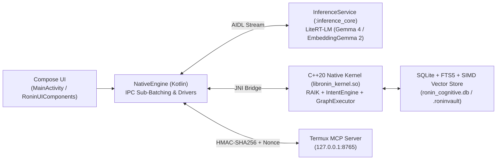

# Ronin Kernel (v5.1.1 — Sovereign Tactical Upgrade)

[](https://github.com/intellibits28/ronin/actions/workflows/build.yml)
[](https://github.com/intellibits28/ronin/actions/workflows/ronin-ci.yml)
[](LICENSE)

> **📥 Download Latest Android APK / နောက်ဆုံးထွက် APK ဒေါင်းလုဒ်ရယူရန်:**  
> 👉 **[Download from GitHub Latest Release (`https://github.com/intellibits28/ronin/releases/latest`)](https://github.com/intellibits28/ronin/releases/latest)**  
> 📖 **[User Guide & Manual (အသုံးပြုသူ လမ်းညွှန် - English / မြန်မာ)](docs/USER_GUIDE.md)** • **[v5.1.1 Release Notes](RELEASE_NOTES_v5.1.1.md)** • **[Changelog](CHANGELOG.md)**

---

## 🌐 Overview (English) | စနစ်မိတ်ဆက် (မြန်မာ)

### 🇬🇧 English Overview
**Ronin** is a sovereign, privacy-first mobile AI runtime and cognitive agent for Android. It combines a **C++20 native microkernel**, Kotlin/JNI integration, isolated on-device **LiteRT-LM (`Gemma 4 E2B` & `EmbeddingGemma 2`)** inference, a **SQLite FTS5 + 16-byte aligned SIMD Vector Store**, and hardware/tool capabilities. Ronin is engineered for autonomous on-device intelligence: observe device state, minimize Variational Free Energy (RAIK), retrieve hybrid lexical/semantic memory, plan multi-step actions, execute capabilities with Human-In-The-Loop (HITL) governance, and analyze physical structural integrity via its **Structural Health Monitoring (SHM v3.0)** DSP subsystem.

### 🇲🇲 မြန်မာဘာသာဖြင့် မိတ်ဆက်
**Ronin Kernel** သည် အင်တာနက်မလိုဘဲ ဖုန်းထဲတွင် သီးသန့် လုံခြုံစွာ အလုပ်လုပ်နိုင်သော **On-Device Sovereign AI Agent** နှင့် **အဆောက်အအုံ ကြံ့ခိုင်မှု တိုင်းတာရေး (SHM) Runtime** ဖြစ်ပါသည်။ C++20 Native Cognitive Microkernel နှင့် Android (Kotlin/Jetpack Compose) တို့ကို တိုက်ရိုက် ပေါင်းစပ်ထားပြီး Google LiteRT-LM (`Gemma 4` နှင့် `EmbeddingGemma 2`) မော်ဒယ်များကို ဖုန်းထဲတွင် Offline အပြည့်အဝ သုံးစွဲနိုင်သကဲ့သို့၊ လိုအပ်ပါက Cloud AI (Gemini, OpenAI, OpenRouter) များနှင့်လည်း ချိတ်ဆက်အသုံးပြုနိုင်ပါသည်။

---

## 🚀 Key Capabilities (v5.1.1 Sovereign Tactical Upgrade) | အဓိက စွမ်းဆောင်ရည်များ

| Feature / စွမ်းဆောင်ရည် | English Description | မြန်မာဘာသာ ရှင်းလင်းချက် |
| :--- | :--- | :--- |
| **🎨 Tactical Brutalist UI & Myanmar Typography** | AMOLED pure black (`#0A0A0A`) theme, unified `8.dp` card geometry, diacritic-safe `21.sp` Myanmar dual-font system, and dismissible `/` command overlay. | AMOLED ဘက်ထရီချွေတာသည့် အနက်ရောင် ဒီဇိုင်း၊ မြန်မာစာ အပေါ်တင်/အောက်မြစ် မပြတ်တောက်သော `21.sp` စာလုံးစနစ်နှင့် အလွယ်တကူ ပိတ်နိုင်သော `/` Command list။ |
| **📚 Hybrid RRF Document RAG (`/docsearch`)** | 3 configurable `EmbeddingGemma 2` tiers (`270M`, `440M`, `740M`), SQLite FTS5 BM25 + 768D SIMD Cosine Similarity fused via Reciprocal Rank Fusion ($k=60$), with `MyanmarSegmenter` fallback. | စာအုပ်နှင့် PDF စာတမ်းကြီးများကို `EmbeddingGemma 2` (Semantic) နှင့် SQLite FTS5 (Lexical) ပေါင်းစပ်ထားသော Hybrid RRF စနစ်ဖြင့် အပိုဒ်လိုက် တိကျစွာ ရှာဖွေပေးခြင်း။ |
| **🔎 Privacy-Aware Local Research (`/research`)** | Queries DuckDuckGo Lite via HTTP `POST` (256 KB stream cap, SSRF DNS-pinning) and synthesizes locally via **Gemma 4 E2B** with `[1][2][3]` citations & **"SAVE TO VAULT"**. | ပြင်ပ Paid API မလိုဘဲ DuckDuckGo Lite မှ ရှာဖွေကာ ဖုန်းတွင်းရှိ Gemma 4 ဖြင့် 100% Local အနှစ်ချုပ်ထုတ်ပေးပြီး Source Citations `[1][2]` များဖြင့် ပြသပေးခြင်း။ |
| **🔌 Hardened Termux MCP Bridge (`/mcp`)** | Loopback `127.0.0.1:8765` bridge secured with HMAC-SHA256, `±30s` timestamp window, 16-byte Nonce LRU anti-replay cache, and strict Capability Policy (`ALLOW`/`CONFIRM`/`DENY`). | Termux ရှိ Developer Tools များနှင့် HMAC-SHA256 + Nonce Anti-Replay စနစ်ဖြင့် လုံခြုံစွာ ချိတ်ဆက်ပြီး ဖိုင်စစ်ဆေးခြင်းနှင့် Git လုပ်ငန်းများ ဆောင်ရွက်နိုင်ခြင်း။ |
| **🏗️ Structural Health Monitoring (SHM v3)** | 100Hz 3-axis accelerometer ingestion, 2048-pt Welch FFT (`pffft`), Modal Validation Engine v3 (<0.05Hz resolution), Kalman NIS tracking, and AI structural review. | ဖုန်း၏ Accelerometer အာရုံခံကိရိယာနှင့် 2048-pt Welch FFT တို့ဖြင့် အဆောက်အအုံ၊ တံတားနှင့် စက်ပစ္စည်းများ၏ တုန်ခါမှုကြိမ်နှုန်း ($F_0$) ကို တိကျစွာ တိုင်းတာစစ်ဆေးပေးခြင်း။ |
| **🧠 Active Inference Kernel (RAIK)** | Karl Friston's Free Energy Principle in a $0.81\ \mu\text{s}$ C++20 hot-loop with 3-state sensory gaze gating (10Hz / 50Hz / 200Hz) and Expected Free Energy ($G(\pi)$) policy routing. | Free Energy Principle (FEP) အပေါ် အခြေခံ၍ ဖုန်းအပူချိန်၊ ဘက်ထရီနှင့် လှုပ်ရှားမှုအလိုက် အာရုံခံကြိမ်နှုန်းကို (10Hz / 50Hz / 200Hz) အလိုအလျောက် ချိန်ညှိပေးခြင်း။ |
| **🛡️ Privacy Shield & `.roninvault` Backup** | On-device PII redaction (Myanmar NRC, phone, email, bank cards) and atomic WAL-checkpointed SQLite backups encrypted with **AES-256-GCM** via Android SAF. | မြန်မာမှတ်ပုံတင် (NRC)၊ ဖုန်းနံပါတ်နှင့် ဘဏ်ကတ်များကို အလိုအလျောက် ဖုံးကွယ်ပေးခြင်းနှင့် မှတ်ဉာဏ် Database ကို AES-256-GCM ဖြင့် ကုဒ်ဝှက်၍ `.roninvault` အဖြစ် သိမ်းဆည်းခြင်း။ |

---

## 📲 Quick Start & APK Installation | စတင်ထည့်သွင်းအသုံးပြုနည်း

1. **Download APK / APK ဒေါင်းလုဒ်ရယူရန်**:
   - Visit **[GitHub Latest Release (`https://github.com/intellibits28/ronin/releases/latest`)](https://github.com/intellibits28/ronin/releases/latest)** and download `ronin-kernel-*.apk`.
   - [GitHub Latest Release](https://github.com/intellibits28/ronin/releases/latest) သို့ ဝင်ရောက်၍ `ronin-kernel-*.apk` ကို ဒေါင်းလုဒ်ဆွဲပြီး Install (သို့မဟုတ် ရှိပြီးသားအပေါ်မှ တိုက်ရိုက် Update) ပြုလုပ်ပါ။
2. **Load Local Brain or Cloud Provider / မော်ဒယ် ချိတ်ဆက်ရန်**:
   - **Local On-Device Mode**: Open **Menu (☰) > Settings > Section 4: Local Brain** and tap **Import Brain (`.litertlm`)** to load `Gemma 4 E2B` or `EmbeddingGemma 2` models.
   - **Cloud Mode**: Open **Settings > Section 3: Cloud Providers** to configure Gemini, OpenAI, OpenRouter, or custom OpenAI-compatible endpoints.
3. **Full User Guide / အသေးစိတ် လမ်းညွှန်**:
   - Read the complete bilingual guide in **[`docs/USER_GUIDE.md`](docs/USER_GUIDE.md)**.

---

## ⚡ Slash Commands Reference | အမြန်သုံး Command များ

| Command | English Function | မြန်မာဘာသာ လုပ်ဆောင်ချက် |
| :--- | :--- | :--- |
| `/help`, `/capabilities` | Show available capabilities and tools | သုံးနိုင်သော စွမ်းဆောင်ရည်နှင့် Tool များ စာရင်းကြည့်ရန် |
| `/status` | Inspect kernel health, thermal state, and RAM | စနစ်၏ ကျန်းမာရေး၊ အပူချိန်နှင့် RAM အခြေအနေ စစ်ဆေးရန် |
| `/research <query>` | Run privacy-aware web research with local Gemma 4 synthesis | DuckDuckGo Lite + Local Gemma 4 ဖြင့် ဝဘ်သုတေသန ပြုလုပ်ရန် |
| `/docsearch <path> <query>` | Hybrid RRF (FTS5 + 768D SIMD Vector) in-document search | စာရွက်စာတမ်းကြီးများထဲမှ အပိုဒ်များကို Hybrid RRF ဖြင့် ရှာဖွေရန် |
| `/summarize <path>` | Sliding-window document summarization | သတ်မှတ်ထားသော ဖိုင်ကို AI ဖြင့် အနှစ်ချုပ်ခိုင်းရန် |
| `/files <keyword>` | Fast SQLite FTS5 file search with `FileResultCard` | ဖုန်းထဲရှိ ဖိုင်များကို အမြန်ရှာဖွေပြီး ကတ်ဖြင့် ပြသရန် |
| `/mcp status\|token\|tools` | Manage and inspect authenticated Termux MCP Bridge | Termux MCP Server ချိတ်ဆက်မှု၊ Token နှင့် Tool စာရင်း စစ်ဆေးရန် |
| `/mcp call <tool> <json>` | Execute Termux MCP tool with HITL confirmation | Termux MCP Tool ကို အတည်ပြုချက်ဖြင့် လှမ်းခေါ်အသုံးပြုရန် |
| `/model`, `/skills` | Inspect active `.litertlm` model and capability nodes | လက်ရှိ သုံးနေသော Model နှင့် Native Skill များကို စစ်ဆေးရန် |
| `/reset`, `/reflect` | Reset KV cache/conversation or trigger reflection | စကားပြောမှတ်တမ်း အသစ်ပြန်စရန် သို့မဟုတ် Reflection run ရန် |

---

## 🏗️ Current Architecture | ဗိသုကာ တည်ဆောက်ပုံ

At runtime, the Android application initializes the native C++20 kernel through `NativeEngine` (`KernelRuntimeContext`) and binds an isolated `InferenceService` running in the `:inference_core` process. User input flows from Jetpack Compose into JNI (`JniExecutionGateway`), through the Active Inference & Intent layers, and either executes a policy-governed skill or invokes the LiteRT-LM reasoning spine.



### Source Map

| Path | Purpose |
| :--- | :--- |
| `src/ronin_kernel.cpp`, `include/ronin_kernel.hpp` | Top-level observe/orient/decide/act kernel loop and world-state hooks. |
| `src/ronin_jni.cpp`, `src/jni/jni_memory_bindings.cpp`, `src/jni/jni_registration.cpp` | Modular JNI registration, memory/vector/hybrid search bindings, governance, and lifecycle hooks. |
| `src/intent_engine.cpp`, `include/intent_engine.h` | Intent classification, slash commands, task planning, skill registry, and thread-safe cloud/model routing. |
| `src/long_term_memory.cpp`, `include/long_term_memory.h` | SQLite v3 persistence, FTS5 sync triggers (`ai`/`ad`/`au`), multi-model vector store (`document_embeddings`), and 16-byte aligned SIMD Hybrid RRF search. |
| `src/capability_policy_engine.cpp`, `assets/capabilities.json` | Centralized capability security policy enforcement and manifest governance. |
| `src/reasoning/`, `include/reasoning/` | Active Inference Kernel (RAIK), Variational Free Energy ($F$), and Expected Free Energy ($G(\pi)$) router. |
| `src/dsp/vibe_monitor.cpp`, `src/dsp/resonance_analyzer.cpp` | Real-time sensor DSP analysis, Modal Validation Engine v3, Welch PSD, and Kalman NIS tracking. |
| `android/app/src/main/kotlin/com/ronin/kernel/MainActivity.kt` | Compose UI host, SAF encrypted `.roninvault` backup/restore, model/traineddata import sanitization. |
| `android/app/src/main/kotlin/com/ronin/kernel/RoninUIComponents.kt` | Tactical Brutalist UI cards (`8.dp`), Myanmar-safe typography, `ResearchResultCard`, `FileResultCard`, and dismissible command overlay. |
| `android/app/src/main/kotlin/com/ronin/kernel/LocalResearchEngine.kt` | DuckDuckGo Lite POST client, 256 KB stream cap, SSRF multi-hop DNS-pinning, and local citation synthesis. |
| `android/app/src/main/kotlin/com/ronin/kernel/McpClientManager.kt`, `scripts/termux_mcp_server.py` | Authenticated Termux MCP client and server with HMAC-SHA256, timestamp, and 16-byte Nonce LRU anti-replay. |
| `android/app/src/main/kotlin/com/ronin/kernel/DocumentIntelligence.kt`, `OcrEngine.kt`, `PrivacyShield.kt`, `PrivacyVault.kt` | Document chunking, 16-chunk IPC sub-batching, ML Kit bilingual OCR, PII redaction, and AES-256-GCM encryption. |

---

## 🛠️ Build & Test | တည်ဆောက်ခြင်းနှင့် စမ်းသပ်စစ်ဆေးခြင်း

### Host Native Build & C++ Tests (18/18 Suites)
```bash
cmake -S . -B build_host -DCMAKE_BUILD_TYPE=Debug
cmake --build build_host -j2
cd build_host && ctest --output-on-failure
```

### Android APK Build & JVM Unit Tests
```bash
cd android
gradle testDebugUnitTest
gradle assembleDebug
```

---

## 📚 Documentation Index | စာရွက်စာတမ်း လမ်းညွှန်များ

* **[`docs/USER_GUIDE.md`](docs/USER_GUIDE.md)**: Complete Bilingual User Guide & Operations Manual (အသုံးပြုသူ လမ်းညွှန် အပြည့်အစုံ).
* **[`RELEASE_NOTES_v5.1.1.md`](RELEASE_NOTES_v5.1.1.md)**: Executive Release Notes for Ronin v5.1.1 Sovereign Tactical Upgrade.
* **[`CHANGELOG.md`](CHANGELOG.md)**: Chronological version history and release changelog.
* **[`docs/MANUAL_INDEX.md`](docs/MANUAL_INDEX.md)**: Master documentation index and deep-dive technical links.
* **[`docs/ARCHITECTURE_CURRENT.md`](docs/ARCHITECTURE_CURRENT.md)**: Production runtime architecture, RAIK math, Hybrid RAG, and security model.
* **[`docs/TECHNICAL_SPECS.md`](docs/TECHNICAL_SPECS.md)**: Native core, Android layer, SQLite v3 schemas, and CI specifications.
* **[`docs/SHM_PIPELINE_V3_ARCHITECTURE.md`](docs/SHM_PIPELINE_V3_ARCHITECTURE.md)**: Modal Validation Engine v3, Welch PSD, and SHM AI Review Pipeline.
* **[`docs/08_SECURITY.md`](docs/08_SECURITY.md)**: Security governance, PII redaction, and vulnerability remediation notes.

---

## 📄 License

This project is licensed under the [MIT License](LICENSE).
