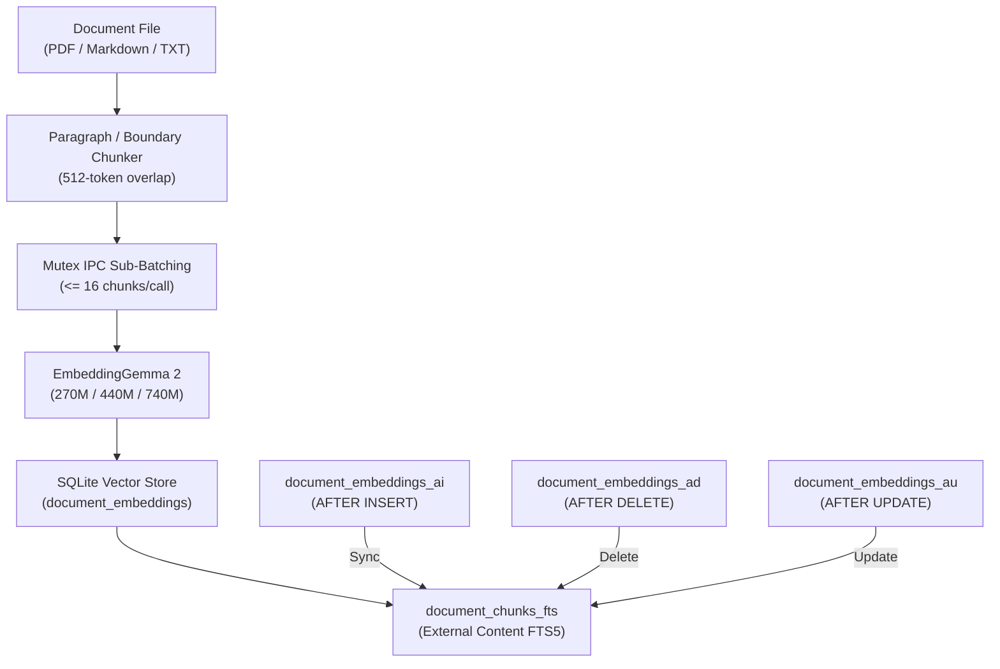

# Ronin v5.1.1 — Sovereign Tactical Upgrade
**Release Notes** • November 7, 2026 • Target Platform: Android 10+ (API 29–35), ARM64-v8a

---

## Executive Summary

**Ronin v5.1.1 Sovereign Tactical Upgrade** is a major engineering and security milestone for the Ronin Kernel. This release establishes a sovereign, privacy-first on-device AI operations system combining:
1. **Tactical Brutalist UI & Myanmar Typography**: High-contrast AMOLED-black aesthetics, `8.dp` unified card geometry, clipping-free Myanmar Unicode dual-font rendering, and dismissible slash command overlays.
2. **On-Demand EmbeddingGemma 2 & Hybrid RRF RAG Engine**: Native C++ SQLite vector store supporting multi-model embedding coexistence, 16-byte aligned SIMD Cosine Similarity, SQLite FTS5 lexical synchronization triggers, and fallback to `MyanmarSegmenter` + FTS5 BM25.
3. **Privacy-Aware Local Research Engine (`/research`)**: 100% local synthesis using Gemma 4 E2B, DuckDuckGo Lite form-encoded search, 256 KB stream limits, SSRF redirect DNS-pinning, inline citations, and explicit "SAVE TO VAULT" persistence with provenance.
4. **Hardened Termux MCP Bridge (`/mcp`)**: Cryptographically signed local agent tool runner with HMAC-SHA256, timestamp replay window, 16-byte random hex nonces, and a strict Capability Security Policy permanently blocking arbitrary shell execution (CodeQL #18 CWE-78).
5. **Pre-Flight Security Remediation**: Full mitigation of vulnerabilities `RONIN-SEC-01` through `RONIN-SEC-08`, including AES-256-GCM encrypted cognitive vault backup/restore (`.roninvault`).
6. **Multi-Centroid Semantic Intent Router & Zero-Credential Vault Safety**: 3-register sub-clustering (`EN`, `MM`, `MIX`), L2 re-normalized centroids ($\|\vec{C}_k\|_2 = 1.0$), top-2 margin ambiguity guard ($S_1 - S_2 \ge 0.04$) with deterministic lexical tie-breaking, non-destructive stateful updates (`PendingSlotState`), and universal value-based regex secret redaction (`[REDACTED_SECRET]`).

---

## Highlights & New Features

### 1. Tactical Brutalist Interface & Myanmar Dual-Font Typography
* **AMOLED Pure Black (`#0A0A0A`)**: Optimized for OLED power efficiency and low-light field operations with high-contrast `#141414` surface cards and `#34D399` emerald accents.
* **Unified `8.dp` Geometry**: Cohesive design language applied across all UI components (`ResearchResultCard`, `FileResultCard`, `ReasoningConsole`, and tool execution prompts).
* **Diacritic-Safe Myanmar Unicode Dual-Font System**: Resolved diacritic clipping (အပေါ်တင်/အောက်မြစ်များ) using `PlatformTextStyle(includeFontPadding = true)` and `LineHeightStyle(Alignment.Center, Trim.None)` with `21.sp` font size and `23.sp` line height.
* **Dismissible Slash Command Overlay**: Fast autocomplete suggestions with 3 dismissal channels (header `✕` button, Android Back gesture, and tap-outside on message bubbles).

### 2. On-Demand EmbeddingGemma 2 & Hybrid RAG (`/docsearch`)
* **3 Configurable Model Tiers**:
  * **Default Tier (`EmbeddingGemma-2-270M`, ~165 MB)**: Lightweight text-only embedding model optimized for 6GB–8GB RAM devices.
  * **Optional Tier (`EmbeddingGemma-2-440M`, ~280 MB)**: Multimodal text + vision embeddings for complex technical diagrams.
  * **Optional Tier (`EmbeddingGemma-2-740M`, ~460 MB)**: Full multimodal embedding model for enterprise document archives.
* **Multi-Model Coexistence**: The SQLite vector store indexes chunks under `UNIQUE(doc_path, model_id, chunk_index)`. Switching embedding models preserves existing vectors across different tiers.
* **Native Lexical Fallback**: When no embedding model is loaded, `/docsearch` falls back to native C++ `MyanmarSegmenter` syllable/word segmentation and SQLite FTS5 BM25 lexical ranking without runtime errors.
* **16-Chunk Sub-Batching**: Mutex-guarded IPC sub-batching limits chunk transfers across Android Binder to `<= 16` chunks per call, preventing `TransactionTooLargeException`.

### 3. Privacy-Aware Local Research Engine (`/research`)
* **Zero Third-Party Cloud LLM Exposure**: Search queries are executed via DuckDuckGo Lite using HTTP POST `application/x-www-form-urlencoded`, preventing query leakage via URL parameters or HTTP referrers.
* **Stream Cap & Resource Protection**: Incoming HTML streams are capped at 256 KB decompressed payload to guard against OOM conditions and zip-bomb attacks.
* **SSRF & DNS-Pinning Protection**: Strict multi-hop redirect validation resolves and inspects each target IP address, blocking loopback (`127.0.0.0/8`, `::1`), private (`10.0.0.0/8`, `172.16.0.0/12`, `192.168.0.0/16`), link-local (`169.254.0.0/16`, `fe80::/10`), CGNAT (`100.64.0.0/10`), multicast (`224.0.0.0/4`), and broadcast ranges.
* **100% Local Gemma 4 E2B Synthesis**: Document content is synthesized on-device with inline numerical citations `[1][2][3]`.
* **Interactive Provenance Persistence ("SAVE TO VAULT")**: Research results are never auto-injected into long-term memory. Users must click **"SAVE TO VAULT"**, which records the report with full metadata (`source_type = "web_research"`, HTTPS source URLs, citations, and timestamp).

### 4. Hardened Termux MCP Bridge (`/mcp`)
* **Secure Loopback Transport**: Connects to `http://127.0.0.1:8765/mcp` without cleartext authorization headers over loopback HTTP.
* **HMAC-SHA256 Cryptographic Authentication**: Request signing via `X-Ronin-Signature` using a 256-bit shared secret (`/mcp token`).
* **Anti-Replay Defense**: Enforces an `X-Ronin-Timestamp` `±30s` window combined with an `X-Ronin-Nonce` 16-byte random hex cache (checked against an in-memory LRU cache).
* **Capability Security Policy**:
  * **`ALLOW`**: Read-only safe inspection (`get_device_info`, `list_files`, `read_file` with 128 KB cap, `git_status`, `git_diff`).
  * **`CONFIRM`**: Modifying operations require interactive Human-In-The-Loop (HITL) user confirmation.
  * **`DENY`**: Arbitrary shell execution (`run_bash`, `shell`, `exec`, arbitrary pipes) is permanently blocked at the server level (CodeQL #18 CWE-78).

### 5. Encrypted Cognitive Vault Backup & Restore (`.roninvault`)
* **Elimination of Cleartext Exports (CWE-312)**: The cognitive database `ronin_cognitive.db` is never copied directly into public storage.
* **Atomic WAL Snapshotting**: Executes `PRAGMA wal_checkpoint(TRUNCATE)` before snapshotting to ensure zero data corruption during active database operations.
* **Hardware-Backed AES-256-GCM Encryption**: Snapshots are encrypted with `PrivacyVault` using AES-256-GCM into `.roninvault` bundles.
* **Scoped Storage Access Framework (SAF)**: Native Android SAF file pickers handle vault export and import securely.

### 6. 4-Phase Active Inference Unified Subsystem Expansion
* **Phase 1 — Dual-Gate BM25 Entropy for Smart RAG Wakeup (`/docsearch`)**: Evaluates temperature-scaled Softmax probabilities and normalized Shannon entropy $\hat{H} \in [0, 1]$ over SQLite FTS5 BM25 scores (`ExpectedFreeEnergyRouter::evaluateRagWakeup`). Selects `LEXICAL_ONLY` (skipping `EmbeddingGemma 2` model swap) iff $|s_1| > \theta_{\text{min}}$ AND $\hat{H} < 0.35$.
* **Phase 2 — Privacy-Weighted Brain Router & Multi-Hop Research (`/research`)**:
  * `evaluateBrainRoute`: Combines pre-inference query complexity $H_{\text{prior}}$ and 8-token speculative probe entropy $H_{\text{probe}}$ with a $+100.0$ pragmatic penalty when `PrivacyShield` detects PII, strictly blocking `ESCALATE_CLOUD`.
  * `evaluateResearchHop`: Governs multi-hop web research with quadratic hop cost $C_{\text{hop}}(k) = c_0 \cdot k^2$ ($k_{\max}=2$) and diminishing-returns early-stopping ($\Delta F < \epsilon$).
* **Phase 3 — Sliding-Window MCP Anomaly Gate & Surprise-Driven Reflection (`/mcp` & `/reflect`)**:
  * 32-slot C++ & Kotlin ring buffer tracking burst rate surprise, path sensitivity (`..`, `.ssh`, `.env`, `/sdcard/dcim`, `ronin_cognitive`), and intent-path divergence; escalates `ALLOW` tools to `MCP_HITL_CONFIRM` when $F_{\text{mcp}} > 0.70$.
  * Write-time `surprise_score` calculation in `LongTermMemory::storeFact` and thermal-gated ($< 38^\circ\text{C}$) top-5 surprise reconciliation during `/reflect`.
* **Phase 4 — Lock-Free Audio Kalman Precision Filter**: Inline real-time sensory precision weighting ($\Pi_{\text{audio}} = \exp(-\beta \cdot \text{noise\_rms})$) in `ResonanceAnalyzer::computeAudioKalmanPrecision` with zero mutex contention.

### 7. Multi-Centroid Semantic Intent Router & Zero-Credential Vault Safety
* **12-Intent Multi-Centroid Sub-Clustering**: Evaluates queries against 3 language-register sub-centroids per intent (`*_EN`, `*_MM`, `*_MIX`) with score max-pooling $\text{score}(k) = \max_{j} (\vec{q} \cdot \vec{C}_{k,j})$, resolving colloquial English, Burmese, and Burm-glish requests without keyword brittleness.
* **Strict L2 Re-Normalization**: Pre-computed centroid vectors and vectorized query embeddings are strictly normalized to unit length ($\|\vec{C}_k\|_2 = 1.0$), ensuring dot products yield exact cosine similarity in $[-1, 1]$.
* **Top-2 Margin Ambiguity Guard & Lexer Tie-Breaker**: Tracks best score $S_1$ and runner-up $S_2$. When $(S_1 - S_2) < 0.04$, a deterministic C++ lexical tie-breaker checks for mutation verbs (`"ပြောင်း"`, `"ပြင်"`, `"update"`, `"change"`) vs creation/read markers (`"သိမ်း"`, `"မှတ်"`, `"ပြ"`, `"save"`, `"show"`), routing unresolved ambiguities to `IntentCategory::CLARIFICATION`.
* **Stateful Multi-Turn Context Carry-Over (`PendingSlotState`)**: If a user requests a vault update without providing the new key, Ronin leaves the existing SQLite entry untouched and prompts the user. When the user provides the key on the next turn, the pending intent (`UPDATE_VAULT`) is automatically fulfilled.
* **Universal Value-Based Secret Pattern Scanner (`CredentialSanitizer`)**: Real-time regex scanner in C++ and Kotlin intercepts and redacts Google API keys (`AIza...`), OpenAI keys (`sk-...`), GitHub PATs (`ghp_...`), Bearer headers, and Burmese assignment markers (`<secret> အဖြစ် / လို့ / သို့`) in-place as `[REDACTED_SECRET]` across logs, DevHUD, telemetry, and UI.

---

## Database & RAG Architecture Details



### Schema & Index Configuration (v3)
```sql
CREATE TABLE IF NOT EXISTS document_embeddings (
    id INTEGER PRIMARY KEY AUTOINCREMENT,
    doc_path TEXT NOT NULL,
    doc_hash TEXT NOT NULL,
    chunk_index INTEGER NOT NULL,
    chunk_text TEXT NOT NULL,
    embedding_blob BLOB NOT NULL,
    model_id TEXT NOT NULL,
    dimension INTEGER NOT NULL,
    created_at INTEGER NOT NULL,
    UNIQUE(doc_path, model_id, chunk_index) ON CONFLICT REPLACE
);

CREATE INDEX IF NOT EXISTS idx_doc_path_model ON document_embeddings(doc_path, model_id);

CREATE VIRTUAL TABLE IF NOT EXISTS document_chunks_fts USING fts5(
    chunk_text,
    content='document_embeddings',
    content_rowid='id'
);
```

### External-Content FTS5 Triggers
To prevent orphaned tokens and stale index entries when documents are re-indexed:
* `document_embeddings_ai`: Synchronizes new chunk text into FTS5 index upon insert.
* `document_embeddings_ad`: Deletes token mappings from FTS5 when rows are removed.
* `document_embeddings_au`: Updates token mappings whenever chunk contents change.

---

## Security Hardening Matrix

| Vulnerability / Advisory | Severity | CWE | Location | Remediation Applied |
| :--- | :--- | :--- | :--- | :--- |
| **RONIN-SEC-01** | High | CWE-22 | `MainActivity.kt` | Sanitized display name using `replace(Regex("[^a-zA-Z0-9._-]"), "_")` and verified `canonicalPath.startsWith(targetDir.canonicalPath)`. |
| **RONIN-SEC-02** | High | CWE-732 | `file_paths.xml` | Removed `<root-path path="." />` and `<external-path>`. Scoped to `documents/`, `attachments/`, `docs/`. |
| **RONIN-SEC-03** | High | CWE-319 | `McpClientManager.kt` | Removed `Authorization: Bearer` over loopback HTTP. Implemented HMAC-SHA256 signature + timestamp + nonce authentication. |
| **RONIN-SEC-04** | Medium | CWE-312 | `MainActivity.kt` | Eliminated cleartext DB copies. Added atomic WAL checkpointing and AES-256-GCM encrypted `.roninvault` SAF exports. |
| **RONIN-SEC-05** | Medium | CWE-1188 | `capability_policy_engine.cpp` | Synchronized asset file paths with `assets/capabilities.json`. |
| **RONIN-SEC-06** | Medium | CWE-362 | `intent_engine.cpp` | Protected dynamic model registry and cloud provider configurations with mutex locks. |
| **RONIN-SEC-07** | Low | CWE-676 | `RoninUIComponents.kt` | Migrated legacy `PreferenceManager` calls to secure settings storage. |
| **RONIN-SEC-08** | Low | CWE-400 | `long_term_memory.cpp` | Added upper bound checks on embedding dimensions (`dim <= 1024`) and byte alignment validation. |
| **CodeQL #18** | High | CWE-78 | `termux_mcp_server.py` | Removed unconstrained `run_bash` execution. Enforced Capability Security Policy (`ALLOW`, `CONFIRM`, `DENY`). |
| **CodeQL #7** | High | CWE-190 | `pffft.c:1161` | Fixed 32-bit multiplication before casting to 64-bit memory offset. |
| **SSRF Mitigation** | High | CWE-918 | `LocalResearchEngine.kt` | Implemented DNS-pinning across redirect hops with rejection of private/loopback/CGNAT/link-local IPv4 and IPv6 addresses. |

---

## Verification & Test Results

* **C++ Core Native Tests**: 18/18 GoogleTest suites passing (`ctest --output-on-failure`).
  * `ronin_atomic_test`: Passed
  * `ronin_integration_test`: Passed
  * `ronin_governance_test`: Passed
  * `ronin_self_healing_test`: Passed
  * `ronin_evolution_test`: Passed
  * `ronin_ltm_schema_migration_test`: Passed (including multi-model coexistence & FTS5 trigger sync)
  * `ronin_segmenter_test`: Passed
  * `ronin_microkernel_test`: Passed
  * `ronin_benchmark_test`: Passed
  * `ronin_resonance_fix_test`: Passed
  * `ronin_shm_pipeline_test`: Passed
  * `ronin_shm_stress_benchmark`: Passed
  * `ronin_cloud_provider_test`: Passed
  * `ronin_intent_benchmark_test`: Passed
  * `ronin_active_inference_test`: Passed
  * `ronin_intent_active_inference_test`: Passed
  * `ronin_shm_sensory_gating_test`: Passed
  * `ronin_active_inference_benchmark`: Passed
* **Android Unit Tests**: 24/24 JVM unit test tasks passing (`gradle testDebugUnitTest`).
* **Continuous Integration**:
  * `Ronin Kernel Build & Test`: Passed (Host tests & debug APK assembly)
  * `Ronin Isolated Inference CI`: Passed (Inference validation & JNI native library build)
  * `CodeQL Security Analysis`: Passed (0 alerts)
