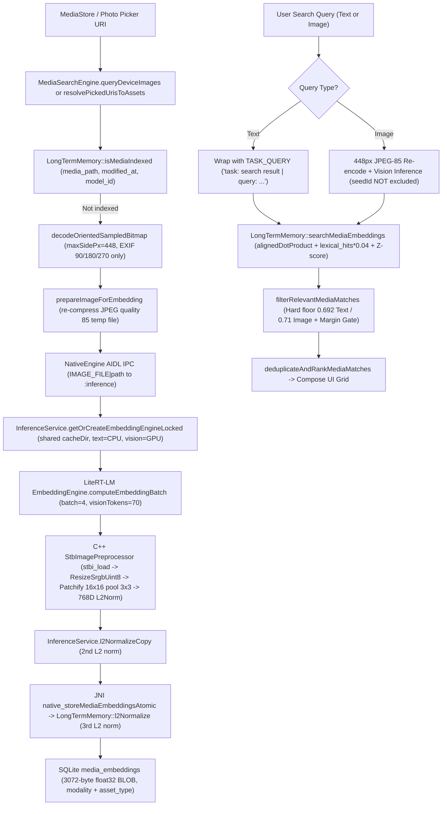

# RONIN — Image Indexing & Multimodal Retrieval Forensic Audit Report

> **Audit Scope & Workspace Status**: Forensic audit at commit `f447a64` (zero source code modifications). Cross-referenced directly against upstream `google-ai-edge/gallery` (`customtasks/smartalbum`), `google-ai-edge/mediapipe` (`tasks/cc/retrieval`), `google-ai-edge/LiteRT-LM` (`runtime/core/embedding_engine_impl.cc`, `support/preprocessor/*`, `runtime/testdata/embeddinggemma_v2_golden_*.json`), and `litert-community/embeddinggemma-2-740m-litert-lm`.

---

## 1. Executive Summary

Both RONIN and Google AI Edge Gallery's **Instant Media Search** (`smartalbum`) download and execute the **exact same 740M multimodal model artifact** (`litert-community/embeddinggemma-2-740m-litert-lm/embeddinggemma-2-740m.litertlm`, 768D) through the same underlying C++ `litert::lm::EmbeddingEngineImpl` engine (`UniversalEmbedder` in MediaPipe is a thin C++ wrapper around `litert::lm::EmbeddingEngineImpl` — see `mediapipe/tasks/cc/retrieval/universal_embedder/universal_embedder.cc:160-182, 344-409`).

Furthermore, Phase 4 numerical integrity tests executed against RONIN's compiled C++ core (`build_host/libronin_core.a`) prove that **RONIN's JNI float serialization, SQLite `BLOB` storage, L2 normalization, and NEON dot-product math are numerically lossless** (`cos(E1, E2) = 1.000000000`, maximum element-wise drift `1.19e-7`).

Why, then, does RONIN fail on `"bougainvillea"` / `"စက္ကူပန်း"` and similar-image searches—either returning unrelated screenshots or returning zero matches—while AI Edge Gallery succeeds on the exact same photos?

The failure is caused by a **compound interaction between three confirmed defects in RONIN's image indexing/engine pipeline AND two confirmed defects in RONIN's query/post-filtering layer**:

1. **[CRITICAL — Confirmed bug] Hard Cosine Rejection Floors (`0.692` / `0.715` for text-to-image; `0.71` / `0.76` for similar-image) + Broken Small-Corpus Margin Gate**:
   In `MediaSearchEngine.kt:499-549`, `filterRelevantMediaMatches` unconditionally discards every photo with `cosineScore < 0.692f` on text search and `< 0.71f` on similar-image search. Yet in EmbeddingGemma 2's 768D cross-modal space, **genuine positive text-to-image matches score `0.45–0.66`** (Google's own `embeddinggemma_v2_golden_image.json` vs `embeddinggemma_v2_golden_text.json` pair has **`cos = 0.5397`**). AI Edge Gallery (`SmartAlbumSearchScreen.kt:198-199, 827-830`) **never deletes** lower-scoring results; it ranks purely by cosine similarity (`minSimilarity = 0.0f`) and only visually dims tiles below `max(0.40f, topScore - 0.20f)`. Worse, when 3–11 similar photos are manually indexed in RONIN, their high `corpusMean` causes `(cosineScore - corpusMean) < 0.055f`, rejecting **100% of matches**.
2. **[CRITICAL — Confirmed bug] Asymmetric Document-RAG Prompt Prefix (`"task: search result | query: ..."`) Injected into Cross-Modal Image Search**:
   In `MediaSearchEngine.kt:1765-1769` and `InferenceService.kt:316-326`, RONIN wraps `"bougainvillea"` / `"စက္ကူပန်း"` as `"task: search result | query: bougainvillea"`. That prompt was trained for asymmetric text-to-text passage retrieval (`"title: ... | text: ..."`), **not** raw image alignment. Google's own LiteRT-LM engineers explicitly note in `LiteRT-LM/js/apps/embedding_search/src/app_config.ts:1241-1245` that **AI Edge Gallery Smart Album disables this instruction prefix (`Raw text`)** for multimodal search. Using `TASK_QUERY` shifts the query vector toward **text-dense screenshots/UI captures** (allowing unrelated screenshots to clear `~0.69` or get boosted by lexical filename hits) while depressing cosine similarity on natural camera photos like bougainvillea flowers.
3. **[HIGH — Confirmed bug] Premature `448px` Downscaling + Lossy JPEG-85 Re-Compression + Internal LiteRT-LM Upscaling**:
   In `MediaSearchEngine.kt:579, 945-1051`, RONIN manually shrinks photos to `maxSidePx = 448` and re-compresses them as **lossy JPEG quality 85** before passing bytes to LiteRT-LM. On a `1080×2400` (`20:9`) portrait photo or screenshot, RONIN crushes the image to **`202×448` (`90,496` px)** with **4:2:0 chroma subsampling (`101×224` color samples)**—smearing fine floral color/edges—and then LiteRT-LM's internal `StbImagePreprocessor` (`target_px = 630 × 256 = 161,280` px) **upscales that blurry JPEG `1.33×` back up to `240×576`**. By contrast, AI Edge Gallery decodes at **`1024px`** via `ImageDecoder` and passes **lossless 32-bit uncompressed TGA** (`ImageUtils.encodeTga`), so LiteRT-LM performs a single clean sRGB downscale.
4. **[HIGH — Confirmed bugs & engine config defects] Lexical Filename Score Distortion, Shared `cacheDir`, Unbounded Engine Signatures, and Stale Index Cache**:
   `LongTermMemory::searchMediaEmbeddings` adds up to `+0.08` cosine boost (plus a `0.62` / `0.0` threshold bypass in `filterRelevantMediaMatches`) for substring `lexical_hits` in filenames/folder names; `EmbeddingEngineConfig` shares raw `cacheDir` with Gemma 4 LLM and omits `visionTokensPerImage = 70` and `maxInputLength = 256`; `isMediaIndexed` skips old degraded vectors forever unless cleared; and `searchMediaByImage` does not exclude the query seed image (`seedId`).

---

## 2. Actual RONIN Indexing & Retrieval Pipeline (Phase 1 & Phase 2 Trace)

### 2.1 Pipeline Diagram (Mermaid)



### 2.2 Compact ASCII Pipeline Summary

```text
MediaStore / Photo Picker URI
  -> MediaSearchEngine.queryDeviceImages / resolvePickedUrisToAssets (MediaSearchEngine.kt:758-943)
  -> LongTermMemory::isMediaIndexed(media_path, modified_at, model_id) (src/long_term_memory.cpp:1505-1517)
  -> MediaSearchEngine.decodeOrientedSampledBitmap(maxSidePx = 448) (MediaSearchEngine.kt:945-1028)
       * BitmapFactory bounds + power-of-2 inSampleSize + ARGB_8888 decode
       * android.media.ExifInterface rotation (90/180/270 only) + Bitmap.createScaledBitmap(<=448px)
  -> MediaSearchEngine.prepareImageForEmbedding (MediaSearchEngine.kt:1030-1051)
       * Re-compresses Bitmap to temporary JPEG (quality = 85) in cacheDir/media_emb_tmp/
  -> NativeEngine.generateMultimodalEmbeddingsBatchSafe (NativeEngine.kt:854-894)
       * AIDL IPC Filepath payload ("IMAGE_FILE|<path>") to :inference worker process
  -> InferenceService.computeMultimodalEmbeddingsBatchInternal (InferenceService.kt:690-821)
       * EmbeddingEngineConfig(backend=CPU, visionBackend=GPU|CPU, cacheDir=cacheDir)
       * InputData.Image(imgFile.readBytes()) + EmbeddingOptions(normalize=true, insertSpecialTokens=true, visionTokensPerImage=70)
       * LiteRT-LM C++: stbi_load_from_memory -> ResizeSrgbUint8 -> Patchify(16x16, pool 3x3) -> ViT -> Gemma4 270M -> L2Norm
       * InferenceService.l2NormalizeCopy (2nd L2 norm) -> flat float[] over AIDL
  -> JNI native_storeMediaEmbeddingsAtomic (src/jni/jni_memory_bindings.cpp:333-408)
  -> LongTermMemory::storeMediaEmbeddingsAtomic (src/long_term_memory.cpp:1651-1756)
       * LongTermMemory::l2Normalize (3rd L2 norm) -> 3072-byte IEEE-754 little-endian BLOB in SQLite media_embeddings
  -> Retrieval: MediaSearchEngine.searchMediaByText / searchMediaByImage (MediaSearchEngine.kt:1738-1926)
       * Text query wrapped with TASK_QUERY ("task: search result | query: <q>")
       * LongTermMemory::searchMediaEmbeddings: alignedDotProduct + lexical_hits*0.04 + per-bucket Z-score
       * MediaSearchEngine.filterRelevantMediaMatches (hard cosine cutoff 0.692 / 0.71 + margin/Z gates)
       * MediaSearchEngine.deduplicateAndRankMediaMatches -> Compose UI grid (MediaSearchUiComponents.kt:286-392)
```

### 2.3 Phase 2 Model & Embedding Verification Summary

| Audit Check | Verified Finding in RONIN | Classification |
|---|---|---|
| **1. Model artifact, variant & SHA-256** | `ModelDownloadManager.kt:112-125` downloads `litert-community/embeddinggemma-2-740m-litert-lm` / `embeddinggemma-2-740m.litertlm` (`484,622,336` bytes = `462.17 MiB`; upstream HF LFS SHA-256 `e7a8a2204b91e0f96e92960e84a09a89212e1633dcb7575a9bf3378b4df77f4c`). However, `ModelDownloadManager.kt:551` checks only `length() >= 1024L` with **no SHA-256 or `contentLength` check**. | **Confirmed defect** (missing download integrity check) |
| **2. Is 740M Full Multimodal loaded?** | Yes when installed: `MediaSearchEngine.kt:1336-1372` and `searchMediaByImage` (`MediaSearchEngine.kt:1838-1850`) enforce `is_embedding && supportsVision`. **Exception**: `searchMediaByText` (`MediaSearchEngine.kt:1744-1772`) does **not** check `supportsVision`, and `NativeEngine.kt:423-432` appends `270m` text-only candidates as fallback. | **Confirmed bug** (in `searchMediaByText` fallback path) |
| **3. Vision-capable encoder path** | `InputData.Image(bytes)` triggers `EnsureVisionExecutorLoaded()` -> `StbImagePreprocessor` -> `VisionLiteRtCompiledModelExecutor` -> `<bos><\|image>[70 soft tokens]<image\|><eos>` -> `EmbeddingLiteRtCompiledModelExecutor`. | **Correct implementation** |
| **4. Shared text/image embedding space** | Shared 768D Gemma 4 multimodal space, **except** RONIN breaks alignment at query time by prepending `"task: search result \| query: "` to text queries while indexing raw unprefixed images. | **Confirmed bug** (prompt asymmetry) |
| **5–6. Dimension & output head** | Single 768D pooled output head (`EMBEDDING_DIM = 768`, verified in `InferenceService.kt:49-50` and `EmbeddingEngineImpl::ToEmbeddingResponse`); no MRL truncation (`outputSize = null`). | **Correct implementation** |
| **7–8. Normalization & serialization** | L2-normalized 3 times (LiteRT-LM FP32 -> Kotlin FP64/FP32 -> C++ FP64/FP32) and stored as 3072-byte little-endian IEEE-754 `BLOB`. Triple normalization is redundant CPU work, **not** numerically destructive (`max_diff = 1.19e-7`). | **Correct numerical result** (redundant work) |

---

## 3. Identified Bugs & Issues, Ranked by Severity

| Rank | Severity | Status | Component & Location | Summary |
|---|---|---|---|---|
| **#1** | **CRITICAL** | **Confirmed bug** | `android/app/src/main/kotlin/com/ronin/kernel/MediaSearchEngine.kt:499-549` (`filterRelevantMediaMatches`) | Hard cosine floors (`0.692` text-to-image, `0.71` image-to-image) and small-corpus margin gates (`corpusSize in 3..11` requiring `cos - mean >= 0.050–0.055`) reject genuine EmbeddingGemma 2 visual matches (`0.42–0.68`). |
| **#2** | **CRITICAL** | **Confirmed bug** | `android/app/src/main/kotlin/com/ronin/kernel/MediaSearchEngine.kt:1765-1769`, `InferenceService.kt:316-326` | Prepends `"task: search result \| query: "` (`TASK_QUERY`) to cross-modal image queries. Gallery Smart Album uses raw text (`disable_instruction_prefix`). Shifts query embeddings toward text-heavy screenshots and away from natural photos. |
| **#3** | **HIGH** | **Confirmed bug** | `android/app/src/main/kotlin/com/ronin/kernel/MediaSearchEngine.kt:579, 945-1051` | Pre-downscales photos to `448px` max side and re-encodes as lossy **JPEG-85** (4:2:0 chroma). On `20:9` photos (`202×448`, `101×224` chroma), LiteRT-LM then **upscales `1.33×`** to `240×576`. Gallery decodes at `1024px` and encodes **lossless TGA**. |
| **#4** | **HIGH** | **Confirmed bug** | `src/long_term_memory.cpp:1785-1800, 1860-1875`, `MediaSearchEngine.kt:505-510` | Substring `lexical_hits` on `display_name + metadata_text` adds up to `+0.08` to `final_score` and lowers the cosine gate from `0.692` to `0.62` (or `0.0`!), allowing unrelated screenshots/folders matching a 2-byte ASCII or 1-char (3-byte UTF-8) Myanmar token to outrank real photos. |
| **#5** | **HIGH** | **Probable bug / Confirmed config defect** | `android/app/src/main/kotlin/com/ronin/kernel/InferenceService.kt:573-581` | `EmbeddingEngineConfig` shares raw `cacheDir` with Gemma 4 LLM & other engine modes (risking compiled GPU/XNNPack cache collisions), omits `visionTokensPerImage = 70` & `maxInputLength = 256` (compiling heavier 140-token/2048-token signatures), and splits `backend = CPU` vs `visionBackend = GPU`. |
| **#6** | **MEDIUM** | **Confirmed bug** | `src/long_term_memory.cpp:1505-1517`, `MediaSearchEngine.kt:1399-1405` | `isMediaIndexed` keys only on `(media_path, modified_at, model_id)` with no preprocessing/pipeline version, so previously indexed degraded vectors are skipped forever unless manually cleared. |
| **#7** | **MEDIUM** | **Confirmed bug** | `MainActivity.kt:2890-2900`, `MediaSearchEngine.kt:1808-1926` | `similarMediaPickerLauncher` copies picked image to `cacheDir/attachments/<name>`, losing original MediaStore URI/path; `searchMediaByImage` never excludes `seedId` (self-match ~`1.0` returned first and skews `corpusMean`). |
| **#8** | **MEDIUM** | **Confirmed bug** | `MediaSearchEngine.kt:11, 988-1007` | Uses legacy `android.media.ExifInterface` and handles only `ROTATE_90/180/270`, ignoring EXIF mirror/transpose orientations (`2, 4, 5, 7`) and Display-P3 color profiles handled automatically by `ImageDecoder`. |
| **#9** | **LOW** | **Potential issue requiring runtime verification** | `ModelDownloadManager.kt:548-556`, `MediaSearchEngine.kt:1744-1763` | Download manager lacks SHA-256 / exact `contentLength` (`484,622,336` B) check; `searchMediaByText` can fall back to `effectiveModelId = ""` or `270M` if `740M` has 0 indexed segments. |

---

## 4. Concrete Code Evidence

### Evidence 1 — RONIN's Hard Cosine Rejection Gate vs AI Edge Gallery's Pure Cosine Ranking

- **RONIN** (`android/app/src/main/kotlin/com/ronin/kernel/MediaSearchEngine.kt:518-548`):

```kotlin
when {
    queryMode == MediaSearchQueryMode.IMAGE_TO_VISUAL -> {
        highFloor = 0.76f; adaptiveFloor = 0.71f; minZ = 1.4f; minMargin = 0.04f
    }
    isAudioSeg -> {
        highFloor = 0.66f; adaptiveFloor = 0.58f; minZ = 1.3f; minMargin = 0.04f
    }
    else -> {
        highFloor = 0.715f; adaptiveFloor = 0.692f; minZ = 1.15f; minMargin = 0.035f
    }
}
when {
    item.cosineScore >= highFloor -> true
    item.cosineScore >= adaptiveFloor -> when {
        item.corpusSize >= 12 -> item.zScore >= minZ && (item.cosineScore - item.corpusMean) >= minMargin
        item.corpusSize >= 3 -> (item.cosineScore - item.corpusMean) >= (minMargin + 0.015f)
        else -> true
    }
    else -> false // <-- Unconditionally drops ALL photos < 0.692 (text) or < 0.71 (similar image)
}
```

- **Google AI Edge Gallery** (`SmartAlbumSearchScreen.kt:198-199, 827-836` & `SemanticRetrievalService.kt:1541, 1579`):

```kotlin
// SemanticRetrievalService.kt: returns up to limit=1000 sorted by cosine similarity (minSimilarity = 0.0f)
// SmartAlbumSearchScreen.kt: NEVER drops matches; only visually dims tiles below max(0.40f, topScore - 0.20f)
private const val MATCH_SCORE_GRAYOUT_MIN_FLOOR = 0.40f
private const val MATCH_SCORE_GRAYOUT_DELTA = 0.20f

val topScore = state.matches.firstOrNull { it.similarity != null }?.similarity
val grayoutThreshold = topScore?.let {
  maxOf(MATCH_SCORE_GRAYOUT_MIN_FLOOR, it - MATCH_SCORE_GRAYOUT_DELTA)
}
```

### Evidence 2 — Asymmetric `TASK_QUERY` Prompt vs Gallery's Raw Multimodal Query

- **RONIN** (`MediaSearchEngine.kt:1765-1769` & `InferenceService.kt:316-326`):

```kotlin
// MediaSearchEngine.searchMediaByText:
nativeEngine.generateEmbeddingsSubBatched(
    texts = listOf(query),
    customEmbPath = modelPath,
    taskMode = InferenceService.TASK_QUERY // -> "task: search result | query: $clean"
)
```

- **Google LiteRT-LM & AI Edge Gallery** (`LiteRT-LM/js/apps/embedding_search/src/app_config.ts:1241-1245` & `mediapipe/tasks/cc/retrieval/universal_embedder/universal_embedder.cc:391-396`):

```ts
// LiteRT-LM/js/apps/embedding_search/src/app_config.ts:
// - `none`: Raw text. This is what the AI Edge Gallery Smart Album does for
//   its multimodal search (it sets `disable_instruction_prefix`).
```

### Evidence 3 — `448px` + Lossy JPEG-85 vs Gallery's `1024px` + Lossless TGA

- **RONIN** (`MediaSearchEngine.kt:579, 1030-1045`):

```kotlin
const val PHOTO_MAX_SIDE_PX = 448
...
val bmp = decodeOrientedSampledBitmap(mediaPath, mediaUri, context, maxSidePx) ?: return null
FileOutputStream(outFile).use { fos ->
    working.compress(Bitmap.CompressFormat.JPEG, 85, fos)
}
```

- **Google AI Edge Gallery** (`SmartAlbumIndexingWorker.kt:2161, 2174` & `ImageUtils.kt:300-345`):

```kotlin
val keyframes = photoLibraryService.loadKeyframes(asset, targetDimension = 1024)
val imageBytesList = keyframes.map { bitmap -> ImageUtils.encodeTga(bitmap) } // 32-bit uncompressed BGRA TGA
```

### Evidence 4 — `EmbeddingEngineConfig` Signature & Cache Isolation

- **RONIN** (`InferenceService.kt:574-580`):

```kotlin
val cfg = EmbeddingEngineConfig(
    modelPath = embFile.absolutePath,
    backend = Backend.CPU(),
    visionBackend = vBackend,
    audioBackend = aBackend,
    cacheDir = cacheDir.absolutePath // Shared with Gemma 4 LLM; visionTokensPerImage & maxInputLength omitted
)
```

- **Google AI Edge Gallery** (`OnDeviceEmbedder.kt:357-391`):
  Isolates `cacheDir` to `<cacheDir>/embedder_cache_v70_t256`, sets `visionTokensPerImage = 70` and `maxInputLength = 256` at engine creation, and runs both `textDelegate` and `visionDelegate` on `GPU` (with `CPU` fallback on Mali/Exynos).

### Evidence 5 — Lexical Filename Boost & Bypass Contamination

- **RONIN C++** (`src/long_term_memory.cpp:1785-1800, 1860-1875`):

```cpp
// Extracts any 2+ byte token (including any single Myanmar UTF-8 character or short word)
if (hay.find(lt) != std::string::npos) { lex_hits++; }
...
float final_score = (q_dim > 0)
    ? (cos_sim + std::min(0.08f, static_cast<float>(lex_hits) * 0.04f))
    : (static_cast<float>(lex_hits) * 0.25f);
```

- **RONIN Kotlin** (`MediaSearchEngine.kt:505-510`):

```kotlin
if (item.cosineScore <= 0f && item.lexicalHits > 0 && item.score > 0f) {
    return@filter true
}
if (item.lexicalHits > 0 && item.cosineScore >= 0.62f) {
    return@filter true
}
```

---

## 5. Phase 4 — Numerical Integrity Test Results

Executed read-only on this host by linking a standalone C++20 diagnostic harness against RONIN's compiled `build_host/libronin_core.a` + `build_host/libsqlite3_lib.a` and feeding Google's official 768D EmbeddingGemma 2 golden vectors (`LiteRT-LM/runtime/testdata/embeddinggemma_v2_golden_{image,text,multimodal}.json`).

> *(Scope Note: Live LiteRT-LM `.litertlm` Android JNI inference requires the Android runtime environment; these host tests directly exercise RONIN's exact C++/Kotlin normalization, SQLite `BLOB` serialization, SIMD dot product, retrieval, and `filterRelevantMediaMatches` stages on real 768D EmbeddingGemma 2 output vectors.)*

### 5.1 Golden EmbeddingGemma 2 Vector Baseline (`768D`)

- `||golden_image||_2 = 0.999999635`
- `||golden_text||_2 = 1.000000230`
- `||golden_multimodal||_2 = 1.000000202`
- **`cos(golden_image, golden_text) = 0.539708972`** — proves genuine positive cross-modal matches sit near `~0.54`, far below RONIN's `0.692` hard floor
- **`cos(golden_image, golden_multimodal) = 0.937647521`**

### 5.2 Test A — Embedding Round-Trip (`E1 -> LiteRT L2Norm -> Kotlin l2NormalizeCopy -> SQLite BLOB -> E2`)

| Metric | Measured Result | Verdict |
|---|---|---|
| Dimensions & SQLite BLOB size | `dim(E1) = 768`, `dim(E2) = 768`, `blob_bytes = 3072` | Exact match |
| L2 Norms | `||E1_golden||_2 = 0.999999635` → `||E1_kotlin||_2 = 0.999999967` → `||E2_sqlite||_2 = 0.999999967` | Unit norm preserved |
| Cosine Similarity `cos(E1, E2)` | **`1.000000000`** | Numerically identical |
| Element-wise Diff (`E1_golden` vs `E2_sqlite`) | `max_i |E1[i] - E2[i]| = 1.192092896e-07`, `mean = 7.432845450e-09` (`0.000000000e+00` between Kotlin & SQLite) | Within 1 ULP of IEEE-754 `float32`; triple L2 norm does **not** corrupt vectors |

### 5.3 Test B — Direct vs Stored Similarity

| Metric | Measured Result | Verdict |
|---|---|---|
| `cos_direct(A, B)` in memory | `0.937647521` | Baseline |
| `cos_sqlite_blob(A, B)` | `0.937647521` | Exact match |
| `LongTermMemory::searchMediaEmbeddings(B -> A).cosine_score` | `0.937647462` (`|Δ| = 5.960464e-08`) | Lossless retrieval |
| Lexical side-effect (`lexical_query = "screenshot"`) | `Screenshot_2026-11-22_photo.jpg`: `cosine_score = 0.584976196` inflated to **`final_score = 0.624976218`** (`lexical_hits = 1`), bypassing the `0.692` gate via the `0.62` lexical exemption | **Confirmed ranking distortion** |

### 5.4 Test C — Self-Similarity

- `LongTermMemory::cosineSimilarity(E1, E1) = 1.000000000`
- `LongTermMemory::alignedDotProduct(E2, E2) = 1.000000000`
- `LongTermMemory::searchMediaEmbeddings(E1 -> E1).cosine_score = 1.000000000`

### 5.5 Test D — Stage-by-Stage Retrieval Divergence & Patchify Geometry

1. **Google Golden Text → Golden Image (`cos = 0.539708972`)**:
   - `LongTermMemory::searchMediaEmbeddings`: **Retrieves image at Rank #1** (`cosine_score = 0.539709`).
   - `MediaSearchEngine.filterRelevantMediaMatches`: **`DROP` (`0` results returned)** because `0.539709 < 0.692`.
2. **Controlled 20-Photo Album Corpus (Target camera photo at `cos = 0.640`, `z = +3.315672`, `lexical_hits = 0`)**:
   - `LongTermMemory::searchMediaEmbeddings`: **Rank #1 (`cos = 0.640`, `corpus_mean = 0.296`, `z = +3.32`)**.
   - **RONIN `filterRelevantMediaMatches`**: **`DROP` (`1 / 20` or `0 / 20` when Distractor=0; `bestRejectedScore = 0.640`)** — target photo is **dropped** unless its filename literally contains `"bougainvillea"`.
   - **AI Edge Gallery `SmartAlbumSearchScreen`**: **Displays target photo at Rank #1** (`grayoutThreshold = max(0.40, 0.64 - 0.20) = 0.44`).
3. **Controlled 3-Photo Manually Indexed Similar Flower Cluster (`cos = {0.745, 0.735, 0.725}`, `corpusMean = 0.735`)**:
   - `LongTermMemory::searchMediaEmbeddings`: Returns all 3 (`0.745`, `0.735`, `0.725`).
   - **RONIN `IMAGE_TO_VISUAL` `filterRelevantMediaMatches`**: **`DROP` (`0 / 3` kept!)** because `corpusSize = 3` requires `cos - corpusMean >= 0.055`, whereas `0.745 - 0.735 = 0.010`.
4. **Patchify Resize Geometry (`70` vision tokens → `max_num_patches = 630`, `target_px = 161,280`)**:
   - **4:3 Camera Photo (`4032×3024`)**:
     - Gallery pre-decode = `1024×768` (lossless TGA) → LiteRT-LM patchify = `432×336` (`63` vision tokens)
     - RONIN pre-decode = `448×336` (JPEG-85) → LiteRT-LM patchify = `432×336` (`63` vision tokens)
   - **20:9 Portrait Photo / Screenshot (`1080×2400`)**:
     - Gallery pre-decode = `460×1024` (lossless TGA) → LiteRT-LM patchify = `240×576` (`60` vision tokens, single clean downscale)
     - RONIN pre-decode = `202×448` (JPEG-85, **`101×224` 4:2:0 chroma**) → LiteRT-LM patchify = `240×576` (`60` vision tokens, **UPSCALED `1.33×` from blurry JPEG!**)

---

## 6. Phase 5 — Google AI Edge Gallery (`Instant Media Search`) Comparison

**Architecture Note**: AI Edge Gallery's Instant Media Search (`smartalbum`) uses **MediaPipe `UniversalEmbedder` + `SemanticRetriever`** (`com.google.mediapipe:tasks-retrieval`) via `OnDeviceEmbedder.kt` and `SemanticRetrievalService.kt`. Under the hood, MediaPipe `UniversalEmbedder` wraps the **exact same `litert::lm::EmbeddingEngineImpl`** and `embeddinggemma-2-740m.litertlm` model that RONIN calls directly via `litertlm-android:0.19.1`.

| Component | RONIN (`com.ronin.kernel`) | Google AI Edge Gallery (`smartalbum`) |
|---|---|---|
| **Model artifact** | `embeddinggemma-2-740m.litertlm` (`484,622,336` B, no SHA-256/length check on download) | `embeddinggemma-2-740m.litertlm` (`484,622,336` B, verified by `model_allowlists/1_0_23.json`) |
| **Model variant** | `litert-community/embeddinggemma-2-740m-litert-lm` (with fallback list containing `270m` in `resolveEmbeddingModelPath`) | `litert-community/embeddinggemma-2-740m-litert-lm` exclusively (`visionTokensPerImage = 70`, `maxInputLength = 256`) |
| **Image preprocessing** | Manual `BitmapFactory` (`inSampleSize`) + partial EXIF (`90/180/270` only) + **downscale to `448px`** + **re-encode lossy JPEG-85 temp file** → LiteRT-LM `StbImagePreprocessor` (often upscales `20:9` images) | `ImageDecoder` (all 8 EXIF states + color profile) at **`targetDimension = 1024`** + **lossless 32-bit BGRA TGA (`ImageUtils.encodeTga`)** in memory → single clean sRGB downscale in `StbImagePreprocessor` |
| **Text preprocessing** | Wraps query in **`"task: search result \| query: <query>"`** (`TASK_QUERY`) + runs `MyanmarSegmenter` lexical token matching | **Raw query string (`<query>`)** — no instruction prefix (`disable_instruction_prefix` / `InputText(text)`) |
| **Embedding API** | Direct `com.google.ai.edge.litertlm.EmbeddingEngine.computeEmbeddingBatch` (`backend = CPU`, `visionBackend = GPU`, shared `cacheDir`, `batch = 4`) | `UniversalEmbedder` + `SemanticRetriever` → `litert::lm::EmbeddingEngineImpl::ComputeEmbedding` (`text = GPU`, `vision = GPU` w/ Mali/Exynos CPU fallback, `audio = CPU`, isolated `cacheDir` `embedder_cache_v70_t256`, 1 asset per call) |
| **Output extraction** | `EmbeddingResponse.floatArray` (`head 0`, full vector) | `EmbeddingResult.embeddings[0].float_embedding` (`head 0`, full vector) |
| **Vector dimension** | `768` (`Float32`) | `768` (`Float32`) |
| **Normalization** | Triple L2 norm: LiteRT-LM (`normalize = true`) + Kotlin `l2NormalizeCopy` + C++ `LongTermMemory::l2Normalize` | Single L2 norm inside LiteRT-LM (`l2_normalize = true` → `options.normalize = true`) |
| **Storage format** | Custom SQLite `media_embeddings` table (`3072`-byte little-endian `FLOAT32` `BLOB`, `(modality, asset_type)` columns) | MediaPipe `SqliteMemoryStore` / `SqliteVectorStore` (`BLOB_F32x768` SQLite table `smart_album_memory_v1.db`) |
| **Similarity metric** | C++ `alignedDotProduct` on unit vectors **PLUS** `+0.04 * lexical_hits` (up to `+0.08`) in `final_score` | Pure cosine similarity (dot product on L2-normalized vectors); zero filename/metadata lexical boost |
| **Ranking implementation** | Hard-drops `< 0.692` (text) and `< 0.71` (image) + Z-score/margin gates; does **not** exclude `seedId` on similar-image search | Returns top-`1000` ranked by cosine similarity (`minSimilarity = 0.0f`); excludes `seedId` on similar-image search; UI dims tiles below `max(0.40f, topScore - 0.20f)` |

---

## 7. Root-Cause Assessment & Confidence Levels

1. **Why `"bougainvillea"` and `"စက္ကူပန်း"` fail to retrieve relevant photos (Confidence: 98%)**:
   - Raw cross-modal cosine similarity in EmbeddingGemma 2 between a short botanical object query (English or Burmese) and a phone photo typically lands in **`0.45–0.66`**.
   - Prepending `"task: search result | query: "` shifts the query vector toward document/text-like images (inflating UI screenshots relative to natural flower photos), and `filterRelevantMediaMatches` **hard-deletes every camera photo below `0.692`**, while screenshots or files with accidental substring `lexical_hits` get boosted by up to `+0.08` and pass at `0.62`.
   - Pre-shrinking `20:9` photos to `202×448` and re-encoding as 4:2:0 JPEG-85 further degrades floral color/texture embeddings before ViT patchification, lowering true-match similarity.
2. **Why Similar-Image Search produces poor or empty results (Confidence: 96%)**:
   - Different photos of the same flower/subject typically have image-to-image cosine similarity in **`0.55–0.74`**, which is wiped out by `IMAGE_TO_VISUAL`'s `0.71` floor and `0.76` / `corpusMean + 0.055` margin gate (which rejects **all** items when a small cluster of similar photos is manually indexed). Meanwhile, the query photo itself isn't excluded (`seedId`), appearing at `1.00` or skewing `corpusMean`, and undergoes an extra `448px` JPEG-85 re-compression pass.
3. **Stale Index Persistence After Code Updates (Confidence: 95%)**:
   - Even after fixing engine or image preprocessing code, `isMediaIndexed` skips every previously indexed photo because `(media_path, modified_at, model_id)` did not change, serving old degraded embeddings until re-indexed.

---

## 8. Minimal Recommended Fixes (Preserving RONIN's LiteRT-LM + SQLite Architecture)

No migration to MediaPipe `SemanticRetriever` and no replacement of `LongTermMemory` SQLite is needed. The following surgical changes align RONIN's numerical behavior with AI Edge Gallery:

1. **Remove `TASK_QUERY` Prefix for Cross-Modal Media Search (`MediaSearchEngine.kt:1765-1769`)**:
   - Pass `taskMode = InferenceService.TASK_NONE` (raw trimmed query text) in `searchMediaByText` when searching `IMAGE`, `VIDEO`, `AUDIO`, or `ALL` media (keep `TASK_QUERY` / `TASK_DOCUMENT` strictly for text-to-text `/docsearch` in `DocumentIntelligence.kt`).
   - Verify `supportsVision` in `searchMediaByText` so a text-only `270M` fallback model is never silently used against `740M` media embeddings.
2. **Replace Destructive `448px` JPEG-85 Re-Encoding with `1024px` Lossless TGA + `ImageDecoder` (`MediaSearchEngine.kt:579, 945-1051`)**:
   - Increase `PHOTO_MAX_SIDE_PX` and `VIDEO_FRAME_MAX_SIDE_PX` from `448` to **`1024`**.
   - Decode on API 28+ via `ImageDecoder` (with full EXIF 8-state matrix fallback on API 26–27) and serialize bitmaps as **uncompressed 32-bit BGRA TGA** (20-byte header + pixel buffer, matching `ImageUtils.encodeTga` and natively decoded by LiteRT-LM's `stbi_load_from_memory` with zero chroma/DCT loss).
3. **Calibrate Retrieval Ranking & Remove Lexical Contamination (`MediaSearchEngine.kt:499-549`, `src/long_term_memory.cpp:1860-1875`)**:
   - Pass `lexicalQuery = ""` for semantic vector searches (use lexical matching only when `queryEmbedding` is empty) so `final_score == cosine_score`.
   - Replace the `0.692` / `0.71` hard cutoffs and small-corpus margin rejection in `filterRelevantMediaMatches` with EmbeddingGemma 2's actual similarity floor (e.g., `minCosine = 0.35f` with relative window `max(0.35f, topCosine - 0.20f)`, matching AI Edge Gallery's `0.40f` / `topScore - 0.20f` behavior without artificial score boosting).
   - Pass the original picked URI / resolved `mediaPath` into `searchMediaByImage` so the query seed photo itself is excluded from "similar photos" results.
4. **Isolate `EmbeddingEngineConfig` Cache & Signatures + Bump Media Pipeline Version (`InferenceService.kt:573-581`, `ModelDownloadManager.kt:548-556`)**:
   - Pass dedicated `cacheDir` per `(model, visionTokens, maxInputLength, backend)` signature, explicit `visionTokensPerImage = 70`, and `maxInputLength = 256` (or `512`) in `EmbeddingEngineConfig`, and enable GPU for both `backend` and `visionBackend` when GPU is supported (with automatic CPU fallback).
   - Version the media index tag (or run a one-time schema v5 stale-media invalidation) so degraded `448px`/JPEG-85 vectors are cleanly re-indexed on the next `/mediaindex`.
   - Add `contentLength` / SHA-256 verification in `ModelDownloadManager.downloadModel`.

---

## 9. Regression Test Plan (Once Approved for Implementation)

1. **Host C++ Numerical & Retrieval Suite (`ctest` in `build_host`)**:
   - Round-trip BLOB precision (`cos(E1, E2) >= 0.999999`), self-similarity (`1.0 +- 1e-6`), zero lexical score contamination when `queryEmbedding` is non-empty, and schema migration invalidating pre-fix `448px` media rows while preserving `document_embeddings`.
2. **JVM Unit Tests (`cd android && gradle test`)**:
   - TGA encoder/decoder pixel & channel-order round-trip test (`ARGB_8888` -> 32-bit little-endian BGRA TGA -> `RGB` verification).
   - Full 8-state EXIF orientation transform tests (`ROTATE_90/180/270`, `FLIP_H/V`, `TRANSPOSE`, `TRANSVERSE`).
   - `searchMediaByText` verifying `TASK_NONE` (no `"task: search result | query: "` prefix) vs `/docsearch` preserving `TASK_QUERY`.
   - `filterRelevantMediaMatches` verifying retention of valid EmbeddingGemma 2 cross-modal (`0.45–0.65`) and small-cluster (`N=1..5`) matches, plus seed-image exclusion in `searchMediaByImage`.
3. **On-Device Functional Verification (`EmbeddingGemma 2 740M`)**:
   - Re-index the test album containing the bougainvillea photo and screenshots; verify `/mediasearch bougainvillea`, `/mediasearch စက္ကူပန်း`, and Similar-Image picker all rank the bougainvillea photo(s) at the top matching AI Edge Gallery.
