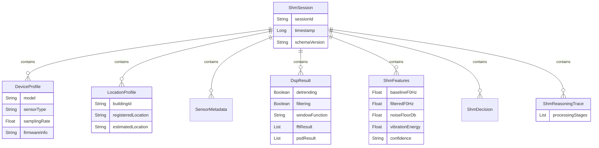

# Ronin SHM Pipeline v3.5 Architecture (Research-Grade DSP & Quality Gating)

This document describes the architectural flow, sequence, mathematical formulation, and data structures for the Structural Health Monitoring (SHM) subsystem in Ronin Kernel v3.5+. It encompasses the 64-bit precision Native DSP engine, Median + 3*MAD non-stationary impulse gating, Nakamura Horizontal-to-Vertical (H/V) spectral ratio validation, the 4-factor Research-Grade Quality Gate, Anomaly-First baseline protection, Kotlin UI bindings, and the production AI Review Pipeline.

## 1. System Overview

The SHM Pipeline operates across three primary layers:
1. **Native C++ Layer (`vibe_monitor.cpp`, `vibe_monitor.h`)**:
   - 64-bit IEEE 754 precision (`double`) biquad filtering for drift removal without limit cycles.
   - Non-stationary impulse segment gating using Median + 3*MAD Welch sub-window rejection.
   - Nakamura Horizontal-to-Vertical (H/V) Spectral Ratio for superstructure sway validation (+10% bonus for sway, -15% penalty for floor slab bounce).
   - 4-Factor Research-Grade Quality Gate (Sensor 30%, Noise 25%, Coupling 25%, Frequency 20%).
   - Anomaly-First Baseline Protection Gate ($|\Delta f_0\%| > 5\%$ or $z > 2\sigma$) with online Welford statistics.
   - Eurocode 8 / ASCE 7 empirical building prior ($f_{\text{expected}} = 10.0\text{ Hz} / N_{\text{floors}}$).
2. **Android UI & State Layer (`ChatViewModel.kt`, `ShmUiComponents.kt`, `ShmSession.kt`)**:
   - Binds live native telemetry, Quality Badge (`RESEARCH_GRADE`, `GOOD`, `FAIR`, `UNRELIABLE`), H/V spectral sway metrics, and baseline variance into Jetpack Compose views.
3. **AI Review & Export Layer (`ShmAiReviewPipeline.kt`, `ShmExportManager.kt`)**:
   - Structures DSP results and quality diagnostics into engineering JSON, sends payloads to local/cloud LLMs for structural engineering review, and exports CSV/JSON.

---

## 2. Mathematical Formulation & DSP Architecture

### 2.1 64-Bit Biquad High-Pass Filter
Direct Form II Transposed filter with 64-bit IEEE 754 coefficients and state registers:
$$y[n] = b_0 x[n] + z_1[n-1]$$
$$z_1[n] = b_1 x[n] - a_1 y[n] + z_2[n-1]$$
$$z_2[n] = b_2 x[n] - a_2 y[n]$$
At $f_c = 0.05\text{ Hz}$ with $f_s = 100\text{ Hz}$, poles are situated at $z \approx 0.9968 \pm j0.0022$. 64-bit precision prevents quantization limit cycles and numerical instability.

### 2.2 Median + 3*MAD Welch Segment Gating
Welch sub-windows ($N_{\text{sub}} = 512$, $50\%$ overlap) with transient impulse noise (footsteps, door slams, dropping objects) are gated out prior to Welch averaging:
$$\text{RMS}_s = \sqrt{\frac{1}{N_{\text{sub}}} \sum_{i=0}^{N_{\text{sub}}-1} x_s[i]^2}$$
$$\widetilde{\text{RMS}} = \text{median}(\{\text{RMS}_s\}), \quad \text{MAD} = \text{median}(|\text{RMS}_s - \widetilde{\text{RMS}}|)$$
$$\tau_{\text{RMS}} = \begin{cases} \widetilde{\text{RMS}} + 3 \times 1.4826 \cdot \text{MAD} & \text{if } \text{MAD} > 10^{-4} \\ 1.35 \cdot \widetilde{\text{RMS}} & \text{otherwise} \end{cases}$$
Segments with $\text{RMS}_s > \tau_{\text{RMS}}$ are excluded from PSD accumulation, preserving ambient noise floor clarity.

### 2.3 Nakamura Horizontal-to-Vertical (H/V) Spectral Ratio
Identifies true building horizontal sway modes versus localized floor slab vibrations:
$$\text{H/V}(f) = \frac{S_{xx}(f) + S_{yy}(f)}{2 \cdot \max(S_{zz}(f), 10^{-12})}$$
- **Horizontal Sway:** $\text{H/V} \ge 2.0 \implies +10\%$ modal score bonus.
- **Floor Slab Bounce:** $\text{H/V} < 0.8 \text{ and } S_{zz} > S_{xx} + S_{yy} \implies -15\%$ modal score penalty.

### 2.4 4-Factor Research-Grade Quality Gate
Scored on a 100-point scale:
1. **Sensor Stability (30%):** Sampling jitter and clock consistency ($f_s \ge 90\text{ Hz}$ and full buffer).
2. **Noise Margin (25%):** SNR in dB minus penalty for gated impulse segments.
3. **Coupling Quality (25%):** Stationary stillness verified via low-pass EMA gravity vector variance ($\sigma_g^2 \le 0.002 \implies 25\text{ pts}$).
4. **Frequency Stability (20%):** Temporal persistence streak ($N \ge 4$) and Kalman uncertainty ($\sigma_{f0} < 0.15\text{ Hz}$).
- Categories: `RESEARCH_GRADE` ($\ge 85$), `GOOD` ($\ge 70$), `FAIR` ($\ge 50$), `UNRELIABLE` ($< 50$).

### 2.5 Anomaly-First Baseline Protection Gate
Prevents damaged structural readings from contaminating healthy baseline statistics:
If baseline is locked and incoming measurement exhibits $|\Delta f_0\%| > 5.0\%$ or $z > 2.0\sigma$:
- Baseline accumulation is **BLOCKED**.
- Anomaly counter increments: `consecutive_anomalies++`.
- `baseline_anomaly_blocked = true`.
When reading is healthy ($|\Delta f_0\%| \le 5.0\%$), incremental online Welford statistics update running mean and standard deviation:
$$\delta = f_0 - \mu_{n-1}, \quad \mu_n = \mu_{n-1} + \frac{\delta}{n}, \quad M_{2,n} = M_{2,n-1} + \delta(f_0 - \mu_n)$$

---

## 3. High-Level Data Flow

```mermaid
graph TD
    classDef native fill:#2E1C38,stroke:#AB47BC,color:#FFF,stroke-width:2px;
    classDef kotlin fill:#1B5E20,stroke:#81C784,color:#FFF,stroke-width:2px;
    classDef ai fill:#01579B,stroke:#4FC3F7,color:#FFF,stroke-width:2px;
    classDef ext fill:#424242,stroke:#BDBDBD,color:#FFF,stroke-width:2px;

    subgraph "Native C++ Layer (DSP)"
        S[Sensor Reality (100Hz)] -->|Raw Accel (X,Y,Z)| EMA[EMA Gravity & Coupling Stillness]
        EMA -->|64-bit Biquad HP & Detrend| GAT[Median + 3*MAD Welch Segment Gate]
        GAT -->|Clean Segments Only| WPSD[Welch PSD (sub=512, nfft=2048)]
        WPSD -->|Per-Axis Spectra| HV[Nakamura H/V Spectral Ratio]
        HV -->|Sway Bonus / Slab Penalty| MVE[Modal Validation Engine v3]
        MVE -->|Outlier Gates & Welford| BLG[Anomaly-First Baseline Protection]
        BLG -->|4-Factor Fusion| QG[Research-Grade Quality Gate]
        QG -->|JSON Telemetry| O[Decision & Telemetry JSON]
    end

    subgraph "Kotlin Android Layer"
        O -->|JNI / String passing| V[ChatViewModel]
        V -->|Updates State| U[ShmResultCard / ShmDetailScreen]
        V -->|Constructs| SS[ShmSession Data Model]
        SS -->|JSON / Human Report| EX[ExportManager & Clipboard]
    end

    subgraph "AI Review Layer"
        SS -->|Truncated / Cleaned Payload| AIR[ShmAiReviewPipeline]
        AIR -->|Prompt + Data| LM{LLM Engine}
        LM -->|Local Execution| G4E2B[Local Gemma 4 E2B]
        LM -->|Cloud API| GPRO[Cloud Gemini / OpenRouter]
        
        G4E2B -->|Raw Text (LaTeX)| C[cleanLatex() Regex]
        GPRO -->|Raw Text| C
        C -->|Parsed AIReviewResult| U
    end

    class S,EMA,GAT,WPSD,HV,MVE,BLG,QG,O native;
    class V,U,SS,EX kotlin;
    class AIR,C ai;
    class G4E2B,GPRO ext;
```

---

## 3. Modal Validation Engine Sequence

The Modal Validation Engine is responsible for filtering out spurious frequencies (scatter) and verifying true structural resonance modes. It ensures F₀ repeatability (CV < 2%).

```mermaid
sequenceDiagram
    autonumber
    participant Sensor as MEMS Accelerometer
    participant VME as VibeMonitorEngine (C++)
    participant MVE as Modal Validation Engine v3
    participant Hysteresis as ShmKalmanFilter (Gates)
    participant Kotlin as ChatViewModel
    participant AI as ShmAiReviewPipeline

    Sensor->>VME: Push 100Hz Batches (X, Y, Z)
    VME->>VME: Apply HP Filter & Detrend
    VME->>VME: Welch PSD (nfft=2048, sub=1024)
    VME->>MVE: Extract Peak Candidates (Stage 1)
    
    rect rgb(46, 28, 56)
        Note right of MVE: Axis Coherence Check
        MVE->>MVE: Merge candidates across X, Y, Z
        MVE->>Hysteresis: Pass merged candidates
        Hysteresis-->>Hysteresis: State: NORMAL -> HYSTERESIS_CANDIDATE
        Hysteresis->>MVE: Reject outliers (e.g. 44Hz)
        Hysteresis-->>Hysteresis: State: HYSTERESIS_CONFIRMED (N >= 6)
    end
    
    MVE->>VME: Final Confirmed Modal Frequencies
    VME->>VME: Compile Reasoning Trace (processing_stages)
    VME->>Kotlin: JNI Emit (JSON String)
    Kotlin->>Kotlin: Update ShmSession (Live binding)
    
    alt User requests AI Review
        Kotlin->>AI: executeReview(ShmSession)
        AI->>AI: Truncate PSD/FFT arrays (Token Optimization)
        AI->>AI: Call Model
        AI->>Kotlin: AIReviewResult (Summary, Observations)
    end
```



---

## 4. `ShmSession` Data Model (ERD)

The `ShmSession` data class acts as the single source of truth for both UI rendering, offline storage, and engineering export.



---

## 5. Key System Guarantees

1. **Token Constraint & Payload Truncation:** Raw FFT and PSD float arrays are excluded or heavily decimated before being sent to Local/Cloud LLMs to respect context window limits and ensure speed.
2. **Dynamic Live Binding:** The UI (Compose `Canvas` for peaks, Text bindings for F₀) reacts instantly to the `ChatViewModel` state changes, ensuring visual fidelity.
3. **Data Immutability:** AI formatting quirks (e.g., LaTeX `$\text{-52 dB}$` outputs) are parsed and sanitized strictly on the UI presentation layer, leaving the underlying raw JSON log untouched.
4. **Copy & Export Integrity:** The system utilizes `LocalClipboardManager` and native Android Intents (`ACTION_SEND`) explicitly rather than implicitly storing large diagnostic strings directly on the OS clipboard, mitigating OEM truncation.
